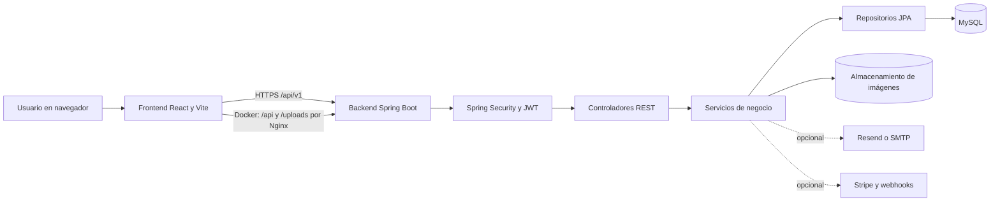

# Arquitectura del sistema

## Vista general

En Render, el frontend estático y el backend son servicios separados. El frontend
usa `VITE_API_URL` y el backend permite el origen web mediante
`CORS_ALLOWED_ORIGINS`. En Docker Compose, Nginx sirve la aplicación compilada,
redirige `/api/` y `/uploads/` al backend y entrega `index.html` para las rutas
del frontend.

## Componentes

### Frontend

- React y Vite construyen una aplicación de una sola página.
- `src/pages/` contiene las pantallas, `src/components/` los componentes
  reutilizables y `src/services/` las llamadas HTTP.
- `VITE_API_URL` define la URL base de la API. En Docker se utiliza el proxy
  interno de Nginx; en hosting separado se configura la URL pública del backend.

### Backend

- Spring Boot expone la API bajo `/api/v1`.
- `controller/` recibe las solicitudes; `dto/` define los contratos; `service/`
  concentra reglas de negocio; `repository/` accede a datos con JPA; y `model/`
  representa las entidades.
- `config/` configura seguridad, CORS, carga de archivos y respuestas de
  autenticación.
- JWT autentica las solicitudes. Los permisos se controlan por rol y las
  contraseñas se almacenan con BCrypt.

### Datos y archivos

- MySQL almacena usuarios, lugares, espacios, reservas, pagos, notificaciones,
  auditoría e incidentes de soporte.
- Hibernate está configurado con `ddl-auto=update` en la configuración actual.
  Antes de operación productiva debe acordarse y probarse una estrategia formal
  de migraciones y compatibilidad hacia atrás.
- Las imágenes se guardan en el directorio `UPLOAD_DIR`; Docker Compose lo monta
  en un volumen persistente. La persistencia en hosting depende del disco
  configurado para el servicio.

### Integraciones opcionales

- El correo utiliza Resend cuando existe `RESEND_API_KEY`; si no, puede usar
  SMTP. El envío requiere `MAIL_ENABLED=true`.
- Stripe usa `STRIPE_SECRET_KEY` y `STRIPE_WEBHOOK_SECRET`. El pago demostrativo
  local no necesita estas credenciales.
- La falta de configuración de estas integraciones no debe confundirse con una
  comprobación de conectividad: el panel de diagnóstico solo indica si detecta
  configuración.

## Ambientes y automatización

- `compose.yaml` levanta MySQL, backend y frontend con volúmenes para datos e
  imágenes. En el host solo publica el puerto del frontend en `127.0.0.1`.
- GitHub Actions ejecuta lint y build del frontend, pruebas y cobertura del
  backend, pruebas de navegador y una comprobación de arranque de Compose.
- El despliegue automatizado existente es manual y está limitado a staging.
  Producción, aprobación explícita y rollback ensayado no están automatizados
  por este repositorio; ver [CD_RENDER.md](CD_RENDER.md).

## Evidencia de verificación

El commit `280aa38` pasó los workflows **CI**, **Docker**, **E2E** y
**E2E staging** el 13 de noviembre de 2026. El job de CI publicó el artefacto
`backend-coverage-report`. Estos resultados prueban esa revisión del código; no
son una aprobación de producción ni sustituyen la revisión funcional del equipo.
